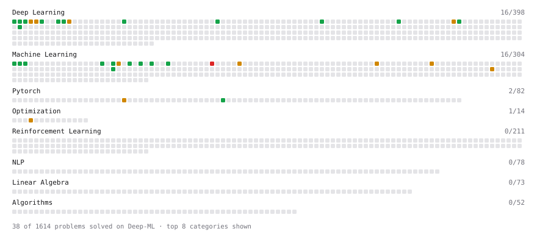

# Deep-ML

My machine learning practice from [Deep-ML](https://www.deep-ml.com). Every solution here was written by hand.

**29** solved · 29 problems · 0 labs · 0 math

[**Browse the interactive portfolio**](https://niteshg97.github.io/deep-ml/) to replay this filling in over time.

## Problems

| | Difficulty | Solved | |
| --- | --- | --- | --- |
| [Calculate Root Mean Square Error (RMSE)](https://www.deep-ml.com/problems/71) | easy | 2026-08-05 | [solution](problems/0071-calculate-root-mean-square-error-rmse) |
| [Compute Multi-class Cross-Entropy Loss](https://www.deep-ml.com/problems/134) | easy | 2026-09-16 | [solution](problems/0134-compute-multi-class-cross-entropy-loss) |
| [Derivatives of Activation Functions](https://www.deep-ml.com/problems/217) | easy | 2026-09-16 | [solution](problems/0217-derivatives-of-activation-functions) |
| [Feature Scaling Implementation](https://www.deep-ml.com/problems/16) | easy | 2026-08-06 | [solution](problems/0016-feature-scaling-implementation) |
| [Generate a Confusion Matrix for Binary Classification](https://www.deep-ml.com/problems/75) | easy | 2026-08-14 | [solution](problems/0075-generate-a-confusion-matrix-for-binary-classification) |
| [Implement Binary Cross-Entropy Loss](https://www.deep-ml.com/problems/263) | easy | 2026-08-10 | [solution](problems/0263-implement-binary-cross-entropy-loss) |
| [Implement Gini Impurity Calculation for a Set of Classes](https://www.deep-ml.com/problems/64) | easy | 2026-08-23 | [solution](problems/0064-implement-gini-impurity-calculation-for-a-set-of-classes) |
| [Implement Gradient Clipping by Value](https://www.deep-ml.com/problems/292) | easy | 2026-09-19 | [solution](problems/0292-implement-gradient-clipping-by-value) |
| [Implement Precision Metric](https://www.deep-ml.com/problems/46) | easy | 2026-08-13 | [solution](problems/0046-implement-precision-metric) |
| [Implement Recall Metric in Binary Classification](https://www.deep-ml.com/problems/52) | easy | 2026-08-14 | [solution](problems/0052-implement-recall-metric-in-binary-classification) |
| [Implement Ridge Regression Loss Function](https://www.deep-ml.com/problems/43) | easy | 2026-08-30 | [solution](problems/0043-implement-ridge-regression-loss-function) |
| [Implement the Hard Sigmoid Activation Function](https://www.deep-ml.com/problems/96) | easy | 2026-08-10 | [solution](problems/0096-implement-the-hard-sigmoid-activation-function) |
| [Implement Weight Decay as L2 Regularization](https://www.deep-ml.com/problems/198) | easy | 2026-09-17 | [solution](problems/0198-implement-weight-decay-as-l2-regularization) |
| [Linear Learning Rate Decay](https://www.deep-ml.com/problems/377) | easy | 2026-09-16 | [solution](problems/0377-linear-learning-rate-decay) |
| [Linear Regression Using Gradient Descent](https://www.deep-ml.com/problems/15) | easy | 2026-08-07 | [solution](problems/0015-linear-regression-using-gradient-descent) |
| [Linear Regression Using Normal Equation](https://www.deep-ml.com/problems/14) | easy | 2026-08-07 | [solution](problems/0014-linear-regression-using-normal-equation) |
| [Sigmoid Activation Function Understanding](https://www.deep-ml.com/problems/22) | easy | 2026-08-10 | [solution](problems/0022-sigmoid-activation-function-understanding) |
| [Single Neuron](https://www.deep-ml.com/problems/24) | easy | 2026-09-09 | [solution](problems/0024-single-neuron) |
| [Decision Tree Pruning with Cost-Complexity](https://www.deep-ml.com/problems/285) | medium | 2026-08-23 | [solution](problems/0285-decision-tree-pruning-with-cost-complexity) |
| [Derivative of Cross-Entropy Loss w.r.t. Logits](https://www.deep-ml.com/problems/220) | medium | 2026-09-17 | [solution](problems/0220-derivative-of-cross-entropy-loss-w-r-t-logits) |
| [Entropy & Cross-Entropy](https://www.deep-ml.com/problems/205) | medium | 2026-08-10 | [solution](problems/0205-entropy-cross-entropy) |
| [Find the Best Gini-Based Split for a Binary Decision Tree](https://www.deep-ml.com/problems/138) | medium | 2026-08-23 | [solution](problems/0138-find-the-best-gini-based-split-for-a-binary-decision-tree) |
| [Gradient Clipping by Global Norm](https://www.deep-ml.com/problems/197) | medium | 2026-09-19 | [solution](problems/0197-gradient-clipping-by-global-norm) |
| [Gradient Clipping by Norm](https://www.deep-ml.com/problems/909) | medium | 2026-09-19 | [solution](problems/0909-gradient-clipping-by-norm) |
| [Implement Adam Optimization Algorithm](https://www.deep-ml.com/problems/49) | medium | 2026-09-16 | [solution](problems/0049-implement-adam-optimization-algorithm) |
| [Implement Stratified Train-Test Split](https://www.deep-ml.com/problems/275) | medium | 2026-08-05 | [solution](problems/0275-implement-stratified-train-test-split) |
| [Single Neuron with Backpropagation](https://www.deep-ml.com/problems/25) | medium | 2026-09-09 | [solution](problems/0025-single-neuron-with-backpropagation) |
| [Stochastic Gradient Descent Step for Linear Regression](https://www.deep-ml.com/problems/802) | medium | 2026-08-16 | [solution](problems/0802-stochastic-gradient-descent-step-for-linear-regression) |
| [Train Logistic Regression with Gradient Descent](https://www.deep-ml.com/problems/106) | hard | 2026-09-28 | [solution](problems/0106-train-logistic-regression-with-gradient-descent) |

---

_This file is regenerated by Deep-ML on every push._
